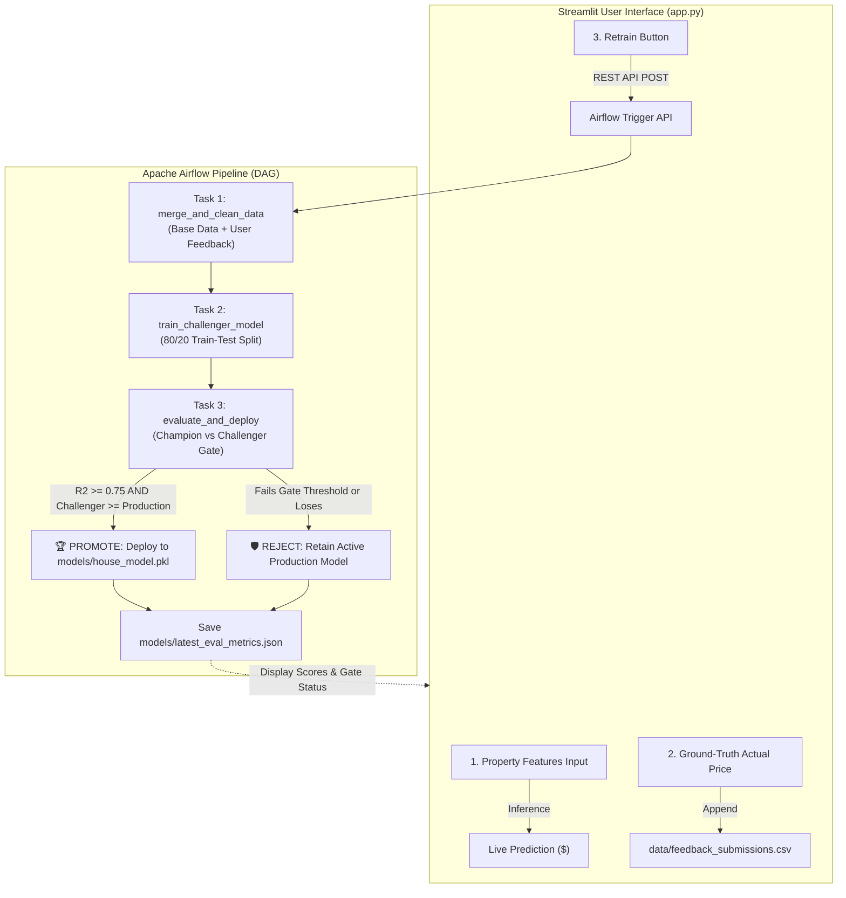

# 🏡 California Housing Price Predictor & Continuous MLOps Retraining Pipeline

An end-to-end, production-ready MLOps system that predicts housing prices, logs continuous ground-truth market feedback, and automatically retrains and gates model deployment using **Apache Airflow**, **Docker Compose**, **Scikit-Learn**, and **Streamlit**.

---

## 🌟 Key Highlights

- **Interactive Streamlit UI (Wide / Landscape Mode):** Real-time price predictions and seamless ground-truth feedback submission.
- **Champion vs. Challenger Quality Gate:** Automated model validation preventing degraded or noisy feedback data from replacing the production model ($R^2 \ge 0.75$ and Challenger $R^2 \ge$ Production $R^2$).
- **One-Click MLOps Trigger:** Authenticated REST API calls from the Streamlit UI directly into Apache Airflow (`/api/v1/dags/.../dagRuns`).
- **Containerized Airflow Stack:** Fully orchestrated Apache Airflow 2.10 (Webserver, Scheduler, PostgreSQL 15, and `LocalExecutor`) with custom Dockerfile baking all ML libraries.
- **Continuous Feedback Loop:** Automatically aggregates baseline training data with new market submissions.

---

## 🏗️ System Architecture



---

## 📁 Repository Structure

```text
├── dags/
│   └── airflow_pipeline.py       # Airflow DAG: 3-stage retraining & evaluation gate
├── data/
│   ├── house_data.csv            # Historical California Housing baseline dataset
│   ├── feedback_submissions.csv  # User-submitted ground-truth feedback records
│   └── holdout_test.csv          # Evaluation holdout split generated during retraining
├── models/
│   ├── house_model.pkl           # Active production Random Forest model
│   └── latest_eval_metrics.json  # Latest validation gate metrics and decision
├── app.py                        # Streamlit landscape dashboard (predict + feedback + metrics)
├── train_model.py                # Initial model training & baseline dataset downloader
├── seed_feedback.py              # Synthetic feedback generator for gate testing
├── docker-compose.yml            # Airflow Webserver, Scheduler & PostgreSQL stack
├── Dockerfile                    # Custom Airflow image with ML dependencies
├── requirements.txt              # Python package requirements
├── .gitignore                    # Git ignore file
└── README.md                     # Comprehensive project documentation
```

---

## ⚙️ Tech Stack

- **Machine Learning:** Scikit-Learn (`RandomForestRegressor`), Pandas, NumPy, Joblib
- **Orchestration:** Apache Airflow 2.10.4, PostgreSQL 15, Docker & Docker Compose
- **Web Interface:** Streamlit (Wide / Landscape Dashboard), Requests
- **Language / Environment:** Python 3.11

---

## 🚀 Getting Started

### 1. Prerequisites
- [Docker Desktop](https://www.docker.com/products/docker-desktop/) (running with Linux containers)
- Python 3.10+ installed locally

### 2. Clone the Repository
```bash
git clone https://github.com/<your-username>/house-price-prediction-airflow.git
cd house-price-prediction-airflow
```

### 3. Install Local UI Dependencies
```bash
pip install -r requirements.txt streamlit requests
```

*(Optional) If you want to train an initial baseline model locally:*
```bash
python train_model.py
```

---

## 🐳 Starting the Airflow Infrastructure

Start PostgreSQL, initialize the Airflow database, and spin up the webserver and scheduler:

```bash
docker compose up -d --build
```

- **Airflow Web UI:** [http://localhost:8081](http://localhost:8081)
- **Default Credentials:**
  - Username: `admin`
  - Password: `admin`

---

## 💻 Running the Streamlit Application

In a new terminal window, launch the dashboard:

```bash
streamlit run app.py
```

Open [http://localhost:8501](http://localhost:8501) in your browser.

---

## 🧪 Testing the Champion / Challenger Quality Gate

1. **Seed Test Feedback:**
   Inject 50 realistic feedback entries into the data pool:
   ```bash
   python seed_feedback.py
   ```

2. **Trigger Retraining:**
   - In the Streamlit dashboard, click **"🚀 Retrain Model via Airflow"**, or trigger it directly via CLI:
     ```bash
     docker compose exec airflow-webserver airflow dags trigger house_retraining_pipeline
     ```

3. **Inspect the Gate Decision:**
   - Check the **Quality Gate & Model Scores** panel in Streamlit.
   - Or review Airflow execution logs:
     ```bash
     docker compose logs -f airflow-scheduler
     ```
   - **Sample Decision Log:**
     ```text
     Challenger Metrics -> R2: 0.8008 | RMSE: 0.5074
     Production Metrics -> R2: 0.9720 | RMSE: 0.1902
     REJECTED: Keeping existing production model. (Challenger R2=0.8008, Prod R2=0.9720, Threshold=0.75)
     ```
     The challenger passed the minimum threshold ($0.75$), but because the incumbent production model scored higher ($0.9720$), the gate **safely rejected the challenger**, preventing live regression.

---

## 🛑 Stopping the Containers

To cleanly stop the Airflow services:
```bash
docker compose down
```

---

## 📄 License
This project is open-source and available under the [MIT License](LICENSE).
